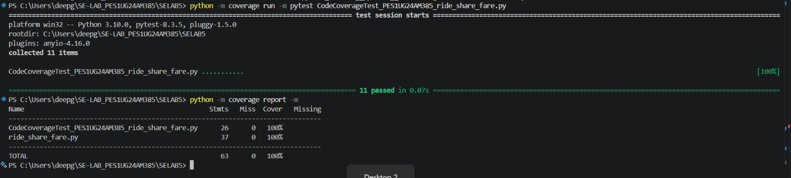
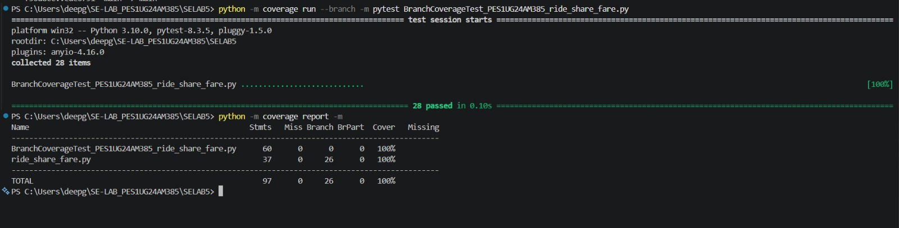

# Lab 5 – Code & Branch Coverage

**SRN:** PES1UG24AM385   
**Tools:** Python 3.10, pytest, coverage.py

## Objective
Write test cases for `ride_share_fare.py` so that both code (line) coverage and branch coverage reach at least 90%.

## Files
| File | Description |
|---|---|
| `ride_share_fare.py` | Application under test |
| `test_ride_share_fare.py` | Starter test file |
| `CodeCoverageTest_PES1UG24AM385_ride_share_fare.py` | Test cases for code coverage |
| `BranchCoverageTest_PES1UG24AM385_ride_share_fare.py` | Test cases for branch coverage |
| `screenshots/` | Coverage report screenshots |

## Results
| Test suite | Tests | Line coverage | Branch coverage |
|---|:---:|:---:|:---:|
| Starter | 2 | 38% | 32% |
| Code coverage | 11 | **100%** | 98% |
| Branch coverage | 28 | **100%** | **100%** |

### Code Coverage


### Branch Coverage


## Observation
The code coverage suite runs every line, but one branch is never taken: a long trip in a zone that is neither `city` nor `outstation`. The branch coverage suite adds a test for this case, which brings branch coverage to 100%. This shows that full line coverage does not mean every decision has been tested.

## How to Run
```bash
pip install coverage pytest

python -m coverage run -m pytest CodeCoverageTest_PES1UG24AM385_ride_share_fare.py
python -m coverage report -m

python -m coverage run --branch -m pytest BranchCoverageTest_PES1UG24AM385_ride_share_fare.py
python -m coverage report -m
```
